# LlamaForge — User Journeys & UX Design

**Version:** 0.1.0-draft  
**Author:** Sumanth Gottipati  
**Date:** 2026-05-14  
**Status:** Design Phase  

---

## Table of Contents

1. [User Personas](#1-user-personas)
2. [Journey Map Overview](#2-journey-map-overview)
3. [Journey 1 — First Install & Bootstrap](#3-journey-1--first-install--bootstrap)
4. [Journey 2 — Model Onboarding & Server Setup](#4-journey-2--model-onboarding--server-setup)
5. [Journey 3 — Daily Operations & Monitoring](#5-journey-3--daily-operations--monitoring)
6. [Journey 4 — API Integration & Client Development](#6-journey-4--api-integration--client-development)
7. [Journey 5 — Configuration Tuning & Hot-Reload](#7-journey-5--configuration-tuning--hot-reload)
8. [Journey 6 — Priority & Scheduling Management](#8-journey-6--priority--scheduling-management)
9. [Journey 7 — Troubleshooting & Debugging](#9-journey-7--troubleshooting--debugging)
10. [Journey 8 — Scaling & Multi-Model Orchestration](#10-journey-8--scaling--multi-model-orchestration)
11. [Journey 9 — Observability & Capacity Planning](#11-journey-9--observability--capacity-planning)
12. [Journey 10 — Maintenance & Lifecycle Operations](#12-journey-10--maintenance--lifecycle-operations)
13. [Cross-Cutting UX Principles](#13-cross-cutting-ux-principles)
14. [Extensibility Framework](#14-extensibility-framework)
15. [UI Surface Mapping](#15-ui-surface-mapping)

---

## 1. User Personas

LlamaForge serves three distinct user tiers. The system architecture — gRPC-primary API, priority task types like `CodeReview` and `CodeGen`, per-requestor quotas, TTFT/throughput metrics — reveals who the system is built for. The OpenAI/Anthropic shim layer and the planned Web UI signal intent to make it accessible beyond the terminal-native crowd.

### Persona 1: The Operator-Developer (Primary)

**Who:** ML/AI engineer or infrastructure-minded developer who runs the forge. They chose local inference deliberately — for latency control, data privacy, cost predictability, or hardware they already own (Apple Silicon, consumer GPUs).

**Characteristics:**
- Comfortable editing TOML, reading structured logs, and interpreting Prometheus metrics
- Cares about TTFT, throughput, GPU utilization, and queue behavior under load
- Runs 1–8 GPUs; may have mixed hardware (an M3 Max laptop + a Linux box with a 3090)
- Likely version-controls their `llamaforge.toml` alongside application code
- Thinks in terms of "how do I squeeze more out of this hardware" and "what happens when my queue backs up"

**Primary surfaces:** Web UI dashboard, CLI, config files, Prometheus/Grafana, structured logs

**Success metric:** Inference infrastructure that self-manages — they check the dashboard, not babysit processes.

### Persona 2: The API Consumer (Secondary)

**Who:** Developer on the same team (or the same person wearing a different hat) who writes code that calls the LlamaForge endpoint. They treat it like a local OpenAI API.

**Characteristics:**
- Uses the OpenAI or Anthropic Python/TS SDK, `curl`, or a gRPC client
- Cares about: "Is my request going to be served? How long will I wait? Can I set priority?"
- Does NOT want to think about which `llama-server` instance handles their request
- May integrate LlamaForge into an IDE plugin, a code review pipeline, or a RAG application
- Expects familiar API shapes — drop-in replacement behavior matters

**Primary surfaces:** `/v1/chat/completions`, `/v1/messages`, SDK integrations, queue position SSE

**Success metric:** `openai.ChatCompletion.create(model="qwen3:30b", ...)` just works, with predictable latency.

### Persona 3: The Power User (Tertiary)

**Who:** Tech-savvy enthusiast running local AI for privacy, hobby projects, or cost avoidance. Less infrastructure experience than Persona 1, but motivated and willing to learn.

**Characteristics:**
- May have followed a blog post or YouTube tutorial to set up `llama-server`
- Wants a GUI — editing TOML and reading logs is tolerable but not preferred
- Cares about: "Is it working? Which model is loaded? Why is it slow?"
- Likely runs a single machine, maybe 1–2 models
- Values the Web UI more than any other surface

**Primary surfaces:** Web UI (exclusively for management), chat application as the API consumer

**Success metric:** Click "Start," see a green status light, and use their models through a chat UI or local app.

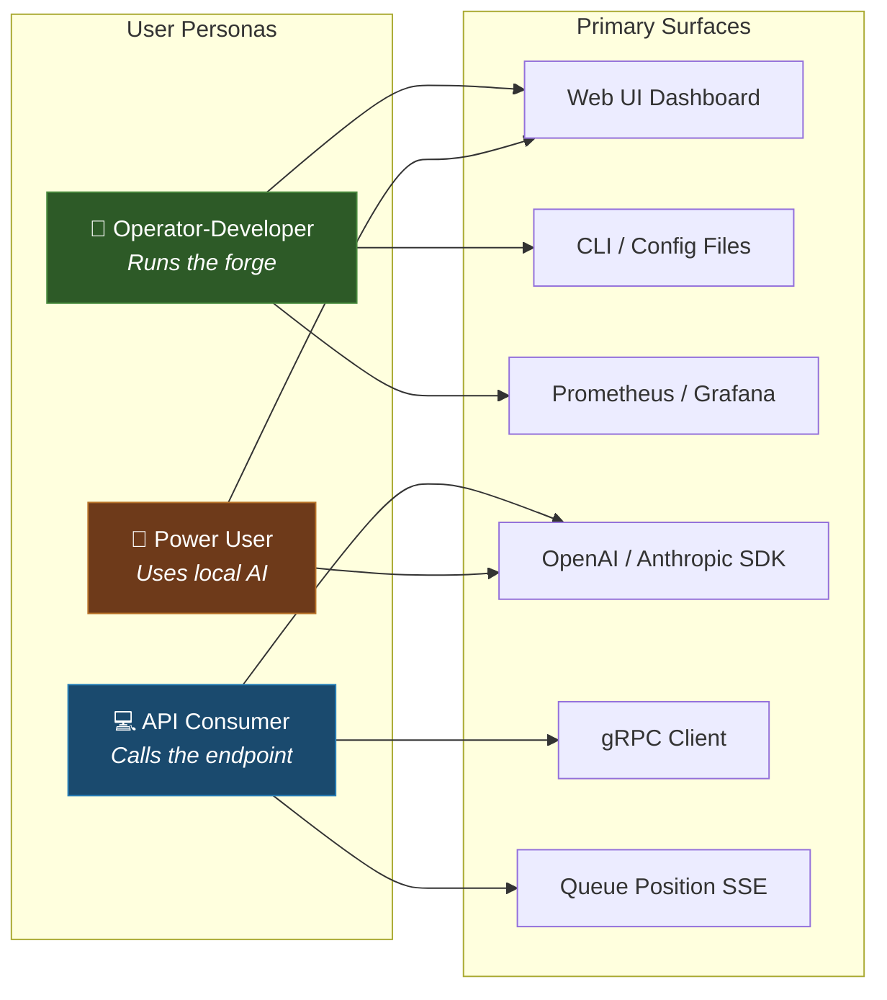

---

## 2. Journey Map Overview

The ten journeys below trace the complete user lifecycle from first contact through mature operations. They are ordered by temporal sequence (when a user first encounters each workflow), not by importance.

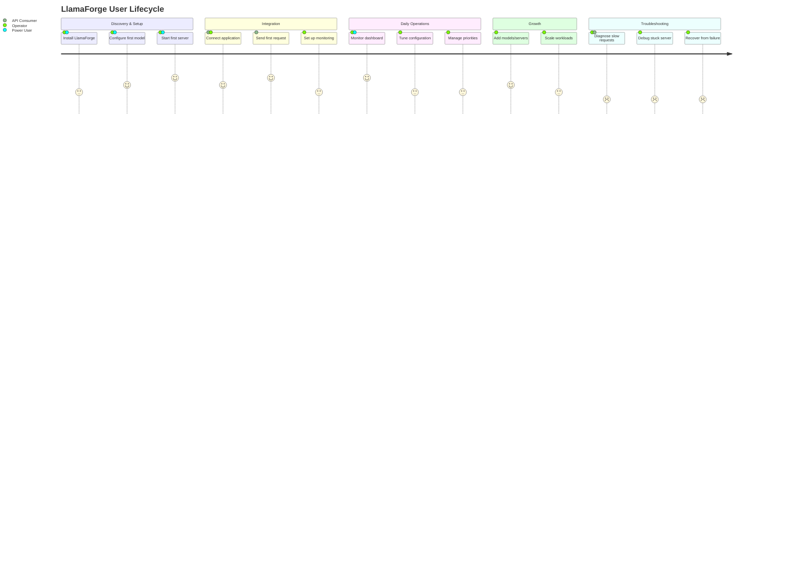

---

## 3. Journey 1 — First Install & Bootstrap

**Persona:** Operator-Developer, Power User  
**Trigger:** User has `llama-server` binary and GGUF models already available; wants orchestration.  
**Goal:** Go from zero to a running LlamaForge instance serving inference requests.

### 3.1 Journey Flow

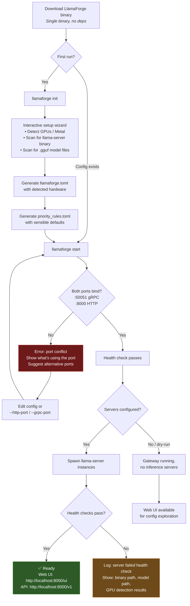

### 3.2 Key UX Moments

**Moment 1: `llamaforge init` — The Setup Wizard**

This is the most critical UX moment in the entire product. The user has just downloaded a binary and has no config file. The wizard must:

1. **Detect hardware** — enumerate GPUs (CUDA `nvidia-smi`, Metal via `system_profiler SPDisplaysDataType`, CPU-only fallback). Display what was found with VRAM amounts.
2. **Find `llama-server`** — search `$PATH`, common locations (`/usr/local/bin`, `~/.local/bin`, Homebrew paths), and ask if not found. Validate the binary by running `llama-server --version`.
3. **Scan for models** — look in common model directories (`~/.cache/huggingface`, `~/models`, paths from environment variables). List found `.gguf` files with sizes and detected quantization levels.
4. **Generate config** — produce a `llamaforge.toml` with sensible defaults based on detected hardware. For each model found, estimate reasonable `n_ctx`, `n_gpu_layers`, and `n_parallel` based on VRAM. Include comments explaining each setting.

The CLI version outputs structured, progressive text. The future desktop client version would present this as a multi-step form.

**Moment 2: First Successful Request**

After `llamaforge start`, the system should print a ready banner with copy-pasteable commands:

```
══════════════════════════════════════════════════════════
  LlamaForge v0.1.0 is ready

  Web UI:     http://localhost:8000/ui
  OpenAI API: http://localhost:8000/v1
  gRPC:       localhost:50051
  Prometheus: http://localhost:8000/metrics

  Servers: 2 running (qwen3-30b on GPU 0, codellama-13b on GPU 1)
  Slots:   12 total (8 + 4)

  Quick test:
    curl http://localhost:8000/v1/chat/completions \
      -H "Content-Type: application/json" \
      -d '{"model": "qwen3-30b", "messages": [{"role": "user", "content": "Hello!"}]}'
══════════════════════════════════════════════════════════
```

### 3.3 Error Recovery Paths

| Error | Display | Recovery |
|-------|---------|----------|
| Port already in use | "Port 8000 is in use by process `ollama` (PID 12345)" | Suggest `--http-port 8001` or show how to change config |
| `llama-server` not found | "Could not find llama-server binary. Searched: ..." | Link to llama.cpp build instructions; suggest `--llama-server-path` |
| Model file not found | "Model path `/path/to/model.gguf` does not exist" | List found models; suggest correcting path |
| Insufficient VRAM | "Model requires ~18GB VRAM but GPU 0 has 12GB available" | Suggest reducing `n_gpu_layers`, using a smaller quant, or offloading to CPU |
| Permission denied | "Cannot bind to port 50051: Permission denied" | Suggest using ports > 1024, or running with appropriate permissions |

### 3.4 CLI Surface

```
llamaforge init              # Interactive first-time setup
llamaforge init --non-interactive --detect  # Auto-detect and generate config
llamaforge start             # Start gateway + spawn servers
llamaforge start --dry-run   # Start gateway only, no inference servers
llamaforge start --config /path/to/llamaforge.toml  # Explicit config
llamaforge status            # Quick health summary
llamaforge stop              # Graceful shutdown (drain + SIGTERM)
```

---

## 4. Journey 2 — Model Onboarding & Server Setup

**Persona:** Operator-Developer  
**Trigger:** User has a new GGUF model file and wants to add it to their running LlamaForge instance.  
**Goal:** Configure a new `llama-server` instance for the model without disrupting existing traffic.

### 4.1 Journey Flow

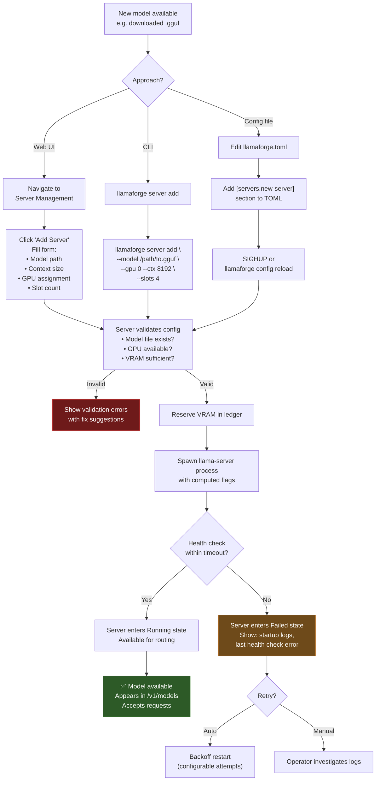

### 4.2 Key UX Moments

**Moment 1: VRAM Estimation & Guidance**

When the user specifies a model + GPU assignment, the UI should proactively compute and display:
- Estimated VRAM usage based on model size, quantization, context length, and slot count
- Current VRAM usage on the target GPU from existing servers
- Whether the allocation will fit, and if not, what to adjust

```
GPU 0 (NVIDIA RTX 3090 — 24 GB)
├── Current: qwen3-30b (Q4_K_M) — 17.2 GB reserved
├── Remaining: 6.8 GB available
└── Requested: codellama-7b (Q5_K_S) — estimated 5.1 GB
    ✅ Fits with 1.7 GB headroom
```

**Moment 2: Live Server Lifecycle in the Web UI**

The Server Management page shows each server as a card with a real-time state machine indicator:

```
┌─────────────────────────────────────────────────┐
│ codellama-13b                          ● Running │
│                                                   │
│ Model:  /models/codellama-13b-Q5_K_S.gguf        │
│ GPU:    GPU 0 (RTX 3090)   VRAM: 8.4 / 24 GB    │
│ Slots:  3/4 active   Context: 8192 tokens        │
│ Uptime: 2d 14h                                    │
│                                                   │
│ ┌─────────┐ ┌──────────┐ ┌───────┐ ┌──────────┐ │
│ │  Stop   │ │ Restart  │ │ Drain │ │  Slots   │ │
│ └─────────┘ └──────────┘ └───────┘ └──────────┘ │
└─────────────────────────────────────────────────┘
```

### 4.3 Server Configuration Parameters

The Web UI "Add Server" form (and corresponding TOML section) exposes the full `llama-server` flag surface grouped by category:

| Category | Parameters | Notes |
|----------|-----------|-------|
| **Model** | `model_path`, `model_alias` | Path to GGUF file; alias for API routing |
| **Compute** | `n_gpu_layers`, `gpu_id`, `use_mmap`, `use_mlock` | GPU offloading and memory mapping |
| **Context** | `n_ctx`, `n_batch`, `n_ubatch` | Context window and batch sizing |
| **Parallelism** | `n_parallel` (slot count) | Concurrent request capacity |
| **Cache** | `cache_type_k`, `cache_type_v`, `flash_attn` | KV cache quantization and flash attention |
| **LoRA** | `lora_adapters[]` | Hot-loadable LoRA adapters |
| **Network** | `port` (auto-assigned), `host` | Managed by LlamaForge |

---

## 5. Journey 3 — Daily Operations & Monitoring

**Persona:** Operator-Developer, Power User  
**Trigger:** User checks in on their running LlamaForge instance.  
**Goal:** Quickly assess system health and identify any issues requiring attention.

### 5.1 Journey Flow

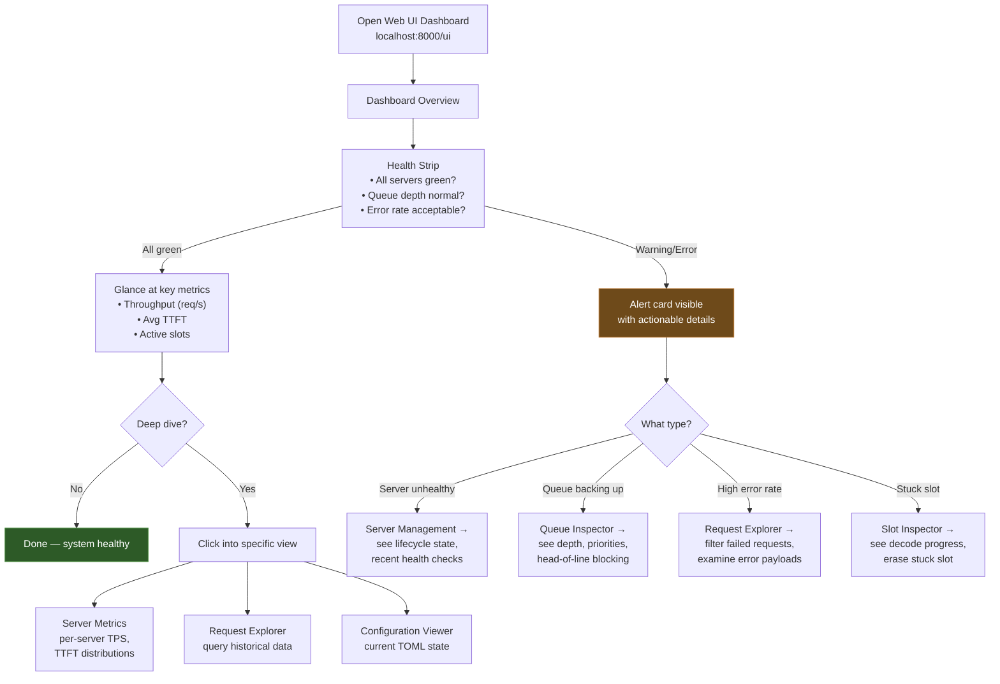

### 5.2 Dashboard Layout

The dashboard follows an information hierarchy: critical alerts first, then aggregate health, then detail views on demand.

```
┌───────────────────────────────────────────────────────────────┐
│  LlamaForge Dashboard                          ⟳ Auto-refresh │
├───────────────────────────────────────────────────────────────┤
│                                                               │
│  HEALTH STRIP                                                 │
│  ┌──────────┐ ┌──────────┐ ┌──────────┐ ┌──────────────────┐ │
│  │ ● Servers │ │ ● Queue  │ │ ● Errors │ │ ● Throughput     │ │
│  │ 3/3 up   │ │ depth: 2 │ │ 0.1%     │ │ 14.2 req/min     │ │
│  └──────────┘ └──────────┘ └──────────┘ └──────────────────┘ │
│                                                               │
│  ┌────────────────────────────────────────────────────────┐   │
│  │ ALERTS (if any)                                        │   │
│  │ ⚠ Server "codellama-7b" restarted 3 times in 10 min  │   │
│  │ ⚠ Queue depth exceeded 80% for > 30s (degraded)      │   │
│  └────────────────────────────────────────────────────────┘   │
│                                                               │
│  ┌──────────────────────┐  ┌──────────────────────────────┐  │
│  │ THROUGHPUT (chart)    │  │ TTFT DISTRIBUTION (chart)    │  │
│  │                       │  │                              │  │
│  │  ╭─╮   ╭───╮         │  │  P50: 180ms                  │  │
│  │ ╭╯ ╰───╯   ╰──╮      │  │  P95: 420ms                  │  │
│  │╭╯              ╰──    │  │  P99: 890ms                  │  │
│  │ ─────────────────     │  │                              │  │
│  │ 1h  30m  15m  5m now  │  │  [histogram visualization]   │  │
│  └──────────────────────┘  └──────────────────────────────┘  │
│                                                               │
│  SERVER CARDS                                                 │
│  ┌─────────────────┐ ┌─────────────────┐ ┌─────────────────┐ │
│  │ qwen3-30b       │ │ codellama-13b   │ │ mistral-7b      │ │
│  │ ● Running       │ │ ● Running       │ │ ● Draining      │ │
│  │ Slots: 6/8      │ │ Slots: 3/4      │ │ Slots: 1/4      │ │
│  │ TPS: 22.4       │ │ TPS: 38.1       │ │ TPS: 0 (drain)  │ │
│  │ TTFT: 210ms     │ │ TTFT: 140ms     │ │                  │ │
│  └─────────────────┘ └─────────────────┘ └─────────────────┘ │
└───────────────────────────────────────────────────────────────┘
```

### 5.3 CLI Equivalent

```
$ llamaforge status
LlamaForge v0.1.0 — up 3d 7h

Servers (3):
  qwen3-30b     ● Running   GPU 0   Slots: 6/8   TTFT: 210ms   TPS: 22.4
  codellama-13b  ● Running   GPU 1   Slots: 3/4   TTFT: 140ms   TPS: 38.1
  mistral-7b    ● Draining  GPU 2   Slots: 1/4   TPS: —

Queue: depth 2 / max 100   |   Throughput: 14.2 req/min   |   Error rate: 0.1%

Alerts:
  ⚠  codellama-7b restarted 3× in 10 min (backoff active)
```

---

## 6. Journey 4 — API Integration & Client Development

**Persona:** API Consumer  
**Trigger:** Developer wants to connect their application to LlamaForge.  
**Goal:** Send inference requests using familiar SDKs with minimal configuration.

### 6.1 Journey Flow

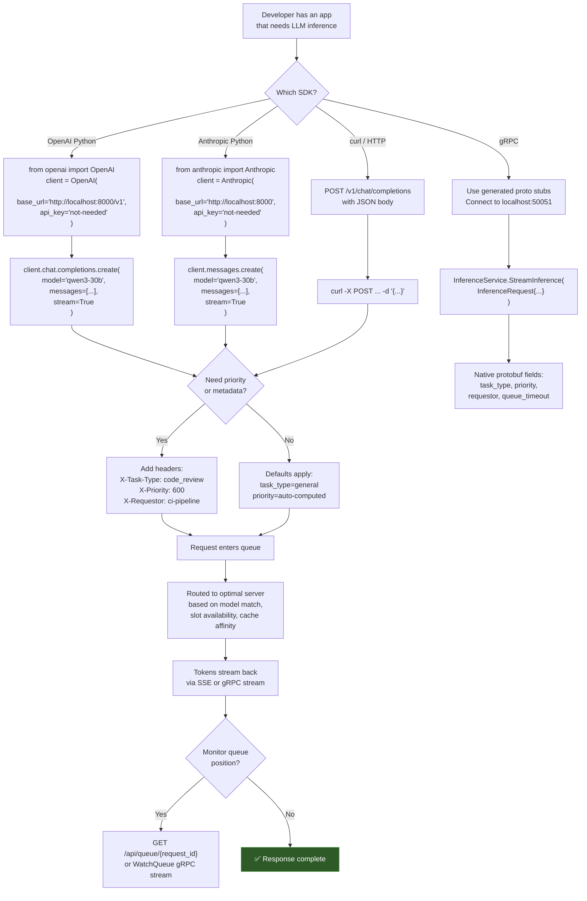

### 6.2 SDK Integration Patterns

**Pattern 1: Drop-in OpenAI Replacement**

The simplest integration — change `base_url` and it works:

```python
# Before (OpenAI cloud)
client = OpenAI(api_key="sk-...")

# After (LlamaForge local)
client = OpenAI(
    base_url="http://localhost:8000/v1",
    api_key="unused"  # LlamaForge v1 doesn't enforce auth
)

# Same API, same streaming, same response format
for chunk in client.chat.completions.create(
    model="qwen3-30b",
    messages=[{"role": "user", "content": "Explain KV caching"}],
    stream=True,
):
    print(chunk.choices[0].delta.content, end="")
```

**Pattern 2: Priority-Aware Requests**

For workloads where some requests matter more than others:

```python
response = client.chat.completions.create(
    model="qwen3-30b",
    messages=messages,
    extra_headers={
        "X-Task-Type": "code_review",
        "X-Requestor": "ci-pipeline",
        "X-Priority": "800",
        "X-Queue-Timeout": "30",
    },
)
```

**Pattern 3: gRPC Native Client**

For maximum control and type safety:

```python
import grpc
from llamaforge.proto import inference_pb2, inference_pb2_grpc

channel = grpc.insecure_channel("localhost:50051")
stub = inference_pb2_grpc.InferenceServiceStub(channel)

request = inference_pb2.InferenceRequest(
    model="qwen3-30b",
    payload=json.dumps({"messages": messages}),
)

for response in stub.StreamInference(request):
    print(response.payload, end="")
```

### 6.3 Queue Position Feedback

When the system is busy, API consumers need visibility into their queue position. LlamaForge provides this through multiple channels:

```
Queue Position Feedback Channels
────────────────────────────────
HTTP SSE:  GET /api/queue/{request_id}/watch
           → data: {"position": 3, "estimated_wait_ms": 4500}
           → data: {"position": 1, "estimated_wait_ms": 1200}
           → data: {"status": "dispatched", "server": "qwen3-30b"}

gRPC:      QueueService.WatchQueue(request_id)
           → stream QueuePositionUpdate

Response:  X-Queue-Wait-Ms: 3200   (header on completed response)
           X-Server-Id: qwen3-30b  (which server handled it)
```

---

## 7. Journey 5 — Configuration Tuning & Hot-Reload

**Persona:** Operator-Developer  
**Trigger:** Operator wants to adjust system behavior without downtime — change context sizes, slot counts, priority rules, or GPU assignments.  
**Goal:** Apply configuration changes with zero dropped requests and predictable rollout.

### 7.1 Journey Flow

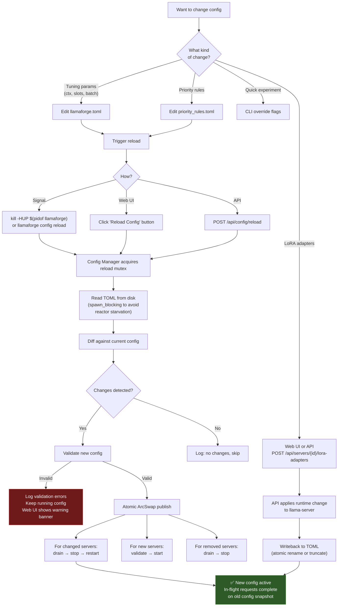

### 7.2 Hot-Reload Contract

The hot-reload system guarantees:

1. **Atomic config snapshots** — Request-processing code calls `ArcSwap::load()` once per request. The returned `Arc<AppConfig>` is a consistent snapshot. No request ever sees a mix of old and new config values.
2. **Serialized reloads** — A `tokio::sync::Mutex<()>` ensures only one reload processes at a time. Rapid SIGHUPs queue, they don't interleave.
3. **Graceful server transitions** — Changed servers drain active requests before restarting. New config parameters take effect only after the restart completes.
4. **No silent config loss** — If the TOML file is read-only (Kubernetes ConfigMap), writeback fails gracefully with a logged warning and a Web UI banner showing divergence.

### 7.3 Configuration Diff in the Web UI

After a reload, the Web UI Configuration Viewer shows what changed:

```
Config Reload — 2026-05-14 10:32:15
────────────────────────────────────
Changes applied:
  servers.qwen3-30b.n_ctx:      4096 → 8192
  servers.qwen3-30b.n_parallel: 4 → 8
  servers.codellama-13b:        (removed)
  servers.deepseek-r1-14b:      (added)

Server actions:
  qwen3-30b:       drain → restart (config changed)
  codellama-13b:   drain → stop (removed)
  deepseek-r1-14b: starting (new)
```

---

## 8. Journey 6 — Priority & Scheduling Management

**Persona:** Operator-Developer  
**Trigger:** Different workloads compete for inference capacity — interactive coding gets slow because batch summarization jobs are consuming all slots.  
**Goal:** Configure priority rules so critical workloads get served first without starving background tasks.

### 8.1 Journey Flow

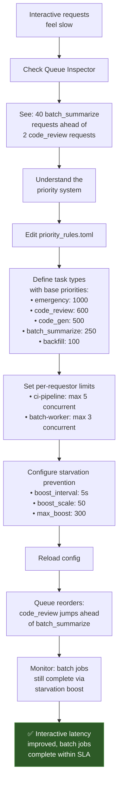

### 8.2 Priority System Visualization (Web UI)

The Queue Inspector should visualize priority ordering:

```
Queue Inspector                                      Depth: 8 / 100
─────────────────────────────────────────────────────────────────────
Pos │ Request ID  │ Task Type      │ Base │ Boost │ Effective │ Wait
────┼─────────────┼────────────────┼──────┼───────┼───────────┼──────
  1 │ req-a3f2... │ emergency      │ 1000 │     0 │      1000 │   0s
  2 │ req-b1c4... │ code_review    │  600 │    12 │       612 │   6s
  3 │ req-d7e8... │ code_gen       │  500 │    45 │       545 │  22s
  4 │ req-f9a0... │ code_gen       │  500 │    38 │       538 │  18s
  5 │ req-c2d3... │ batch_summary  │  250 │   142 │       392 │  85s
  6 │ req-e4f5... │ batch_summary  │  250 │   128 │       378 │  72s
  7 │ req-g6h7... │ backfill       │  100 │   189 │       289 │ 120s
  8 │ req-i8j9... │ backfill       │  100 │   176 │       276 │ 110s
─────────────────────────────────────────────────────────────────────
                                          [Cancel] [Boost] [Details]

Starvation boost formula: boost = min(50 × ln(1 + intervals), 300)
  where intervals = wait_time / 5s
```

### 8.3 Admission Control View

The Web UI also surfaces admission control state:

```
Admission Control
─────────────────────────────────────────────────
Requestor         │ Active │ Limit │ Queued │ Status
──────────────────┼────────┼───────┼────────┼──────
ci-pipeline       │    4   │   5   │    2   │ ✅
batch-worker      │    3   │   3   │    6   │ ⚠ At limit
ide-plugin        │    1   │  10   │    0   │ ✅
anonymous         │    2   │  20   │    0   │ ✅
──────────────────┼────────┼───────┼────────┼──────
Total             │   10   │       │    8   │
```

---

## 9. Journey 7 — Troubleshooting & Debugging

**Persona:** Operator-Developer  
**Trigger:** Something is wrong — requests are slow, failing, or servers are misbehaving.  
**Goal:** Quickly identify the root cause and resolve the issue.

### 9.1 Diagnostic Decision Tree

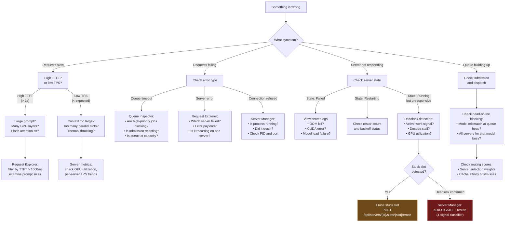

### 9.2 Troubleshooting Surfaces

**Request Explorer — The Primary Debugging Tool**

The Request Explorer queries the SQLite audit log. It is the operator's main tool for answering "what happened?"

```
Request Explorer                                    [Filter ▾] [Export CSV]
─────────────────────────────────────────────────────────────────────────────
Filter: status=failed  model=qwen3-30b  last 1h
─────────────────────────────────────────────────────────────────────────────
Time       │ Request ID    │ Model     │ Status │ TTFT  │ TPS  │ Error
───────────┼───────────────┼───────────┼────────┼───────┼──────┼───────────
10:32:14   │ req-a3f2...   │ qwen3-30b │ Failed │ —     │ —    │ ServerError
10:31:58   │ req-b1c4...   │ qwen3-30b │ Failed │ 180ms │ 2.1  │ StreamReset
10:31:42   │ req-d7e8...   │ qwen3-30b │ Failed │ —     │ —    │ QueueTimeout
─────────────────────────────────────────────────────────────────────────────

[Click row to expand details:]
┌─────────────────────────────────────────────────────────────────────┐
│ Request req-a3f2...                                                 │
│                                                                     │
│ Timeline:                                                           │
│   10:32:14.001  Admitted (priority: 500, task: code_gen)            │
│   10:32:14.003  Queued at position 0                                │
│   10:32:14.005  Routed to qwen3-30b (server-1, slot 3)             │
│   10:32:14.012  Dispatched to llama-server :8081                    │
│   10:32:14.450  Error: upstream connection reset                    │
│                                                                     │
│ Prompt: 2,340 tokens (truncated)                                    │
│ Server: qwen3-30b (server-1)  State at time: Running               │
│ Slot: 3  Cache hit: no                                              │
│ Queue wait: 2ms  Total time: 449ms                                  │
│                                                                     │
│ Error details:                                                      │
│   reqwest::Error { kind: Request, source: hyper::Error(             │
│     IncompleteMessage) }                                            │
│   → Upstream llama-server closed connection mid-response.           │
│   → Likely cause: OOM during generation or process crash.           │
│   → Check: llamaforge logs for server-1 health status at 10:32:14  │
└─────────────────────────────────────────────────────────────────────┘
```

**Structured Log Explorer**

For operators who prefer logs over UI, LlamaForge's structured JSON logging enables powerful filtering:

```bash
# Find all requests that waited > 5s in queue
llamaforge logs --filter 'queue_wait_ms > 5000' --last 1h

# Trace a specific request through the system
llamaforge logs --request-id req-a3f2... --follow

# Watch server lifecycle events
llamaforge logs --filter 'component=server_manager' --level warn --follow

# Find starvation boost events
llamaforge logs --filter 'event=starvation_boost' --last 30m
```

### 9.3 Common Troubleshooting Scenarios

| Symptom | First Check | Likely Cause | Resolution |
|---------|------------|--------------|------------|
| All requests timing out | `llamaforge status` | All servers in Failed state | Check model paths, GPU availability, VRAM |
| Intermittent slow TTFT | Request Explorer, sort by TTFT | Large prompt hitting cold cache | Enable `cache_prompt: true`, check affinity routing |
| One model's requests always queued | Queue Inspector | Only one server for that model, slots saturated | Add another server instance for the model |
| Server restart loop | Server Management, view restart history | OOM, CUDA error, corrupt model | Check server logs, reduce `n_ctx` or `n_parallel` |
| Stuck slot (no decode progress) | Slot Inspector, stuck detection | llama-server internal deadlock | Erase the slot; if recurring, restart server |
| Config reload does nothing | Web UI config diff | TOML parse error, or no actual changes | Check reload log for validation errors |
| High error rate from one requestor | Request Explorer, filter by requestor | Malformed requests or hitting limits | Check admission control; review requestor's request format |

### 9.4 Health Signal Reference

LlamaForge exposes three health signals that the Web UI and CLI surface prominently:

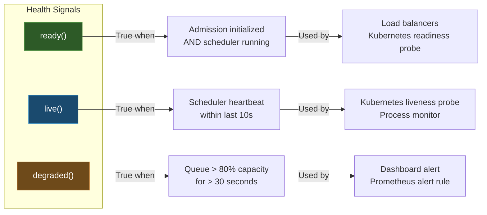

---

## 10. Journey 8 — Scaling & Multi-Model Orchestration

**Persona:** Operator-Developer  
**Trigger:** Workload has grown. User needs to serve multiple models, distribute load across GPUs, or handle more concurrent requests.  
**Goal:** Scale from a single model/server setup to a multi-model fleet without redesigning the config.

### 10.1 Journey Flow

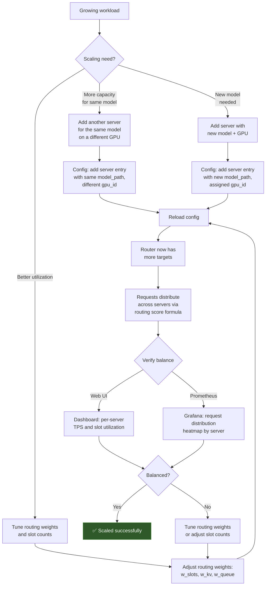

### 10.2 Multi-Model Configuration Example

A mature deployment might look like this:

```toml
# llamaforge.toml — Multi-model fleet

[global]
queue_capacity = 200
starvation_boost_interval_secs = 5

# Primary code model — two instances for capacity
[servers.code-1]
model_path = "/models/qwen3-30b-Q4_K_M.gguf"
model_alias = "qwen3-30b"
gpu_id = 0
n_ctx = 8192
n_parallel = 8
flash_attn = "auto"

[servers.code-2]
model_path = "/models/qwen3-30b-Q4_K_M.gguf"
model_alias = "qwen3-30b"
gpu_id = 1
n_ctx = 8192
n_parallel = 8
flash_attn = "auto"

# Fast small model for quick tasks
[servers.fast]
model_path = "/models/mistral-7b-Q5_K_S.gguf"
model_alias = "mistral-7b"
gpu_id = 2
n_ctx = 4096
n_parallel = 12
flash_attn = "auto"

# Specialized model with LoRA
[servers.review]
model_path = "/models/codellama-13b-Q5_K_S.gguf"
model_alias = "codellama-13b"
gpu_id = 3
n_ctx = 16384
n_parallel = 4
flash_attn = "auto"

[[servers.review.lora_adapters]]
name = "code-review-v2"
path = "/models/lora/code-review-v2.gguf"
scale = 1.0
```

### 10.3 Routing Score Visualization (Web UI)

When an operator is tuning routing, the Web UI should show how the routing score formula evaluates for each server:

```
Routing Score Breakdown for: model=qwen3-30b
─────────────────────────────────────────────────────────────────
Server   │ Free Slots │ KV Usage │ Queue │ Affinity │ TOTAL
─────────┼────────────┼──────────┼───────┼──────────┼──────
code-1   │  0.35 ×0.4 │ 0.72 ×0.3│ 0.9×0.2│ 0.0 ×0.1│ 0.554
code-2   │  0.62 ×0.4 │ 0.45 ×0.3│ 1.0×0.2│ 0.0 ×0.1│ 0.683 ★
─────────────────────────────────────────────────────────────────
Score = w_slots×free_ratio + w_kv×(1-kv_usage) + w_queue×(1-deferred) + w_affinity×0

★ = Selected server for next request
```

---

## 11. Journey 9 — Observability & Capacity Planning

**Persona:** Operator-Developer  
**Trigger:** Operator wants to understand usage patterns, plan capacity, or set up alerting.  
**Goal:** Build a monitoring stack that provides proactive visibility into system health and usage trends.

### 11.1 Observability Stack

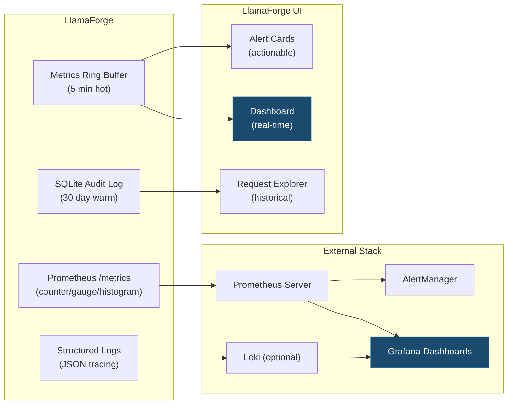

### 11.2 Key Metrics for Capacity Planning

The Web UI and Prometheus export these metrics. The capacity planning view surfaces trends and projections:

```
Capacity Planning View (Web UI)
─────────────────────────────────────────────────────────────
                    Current     7d Avg    30d Avg    Trend
─────────────────────────────────────────────────────────────
Requests/hour       142         128       98         ↑ 45%
Peak queue depth    12          8         4          ↑ 200%
Avg TTFT (P50)      180ms       165ms     150ms      ↑ 20%
Avg TTFT (P99)      890ms       720ms     580ms      ↑ 53%
Slot utilization    72%         65%       52%        ↑ 38%
GPU memory used     68%         62%       55%        ↑ 24%
Error rate          0.1%        0.08%     0.05%      ↑ 100%
─────────────────────────────────────────────────────────────

Projection: At current growth rate, queue capacity will become
a bottleneck in approximately 3 weeks. Consider:
  • Adding a server instance for qwen3-30b (highest demand model)
  • Increasing queue_capacity from 100 to 200
  • Reviewing batch_summarize requestor limits
```

### 11.3 Prometheus Metrics Reference

Key metrics exported at `/metrics`:

| Metric | Type | Labels | Purpose |
|--------|------|--------|---------|
| `llamaforge_requests_total` | counter | `model`, `task_type`, `status` | Total request count |
| `llamaforge_tokens_total` | counter | `model`, `direction` (prompt/completion) | Token throughput |
| `llamaforge_ttft_seconds` | histogram | `model` | Time-to-first-token distribution |
| `llamaforge_queue_depth` | gauge | — | Current queue depth |
| `llamaforge_queue_wait_seconds` | histogram | `task_type` | Queue wait time distribution |
| `llamaforge_server_slots_active` | gauge | `server_id` | Slots currently processing |
| `llamaforge_server_slots_total` | gauge | `server_id` | Total configured slots |
| `llamaforge_dispatch_duration_seconds` | histogram | `model` | Time from dequeue to first byte |
| `llamaforge_server_restarts_total` | counter | `server_id` | Server restart count |
| `llamaforge_events_dropped_total` | counter | — | Telemetry events dropped (back-pressure) |

---

## 12. Journey 10 — Maintenance & Lifecycle Operations

**Persona:** Operator-Developer  
**Trigger:** Planned maintenance — upgrading llama-server, swapping models, upgrading LlamaForge itself, or database maintenance.  
**Goal:** Perform maintenance with minimal disruption.

### 12.1 Journey Flow

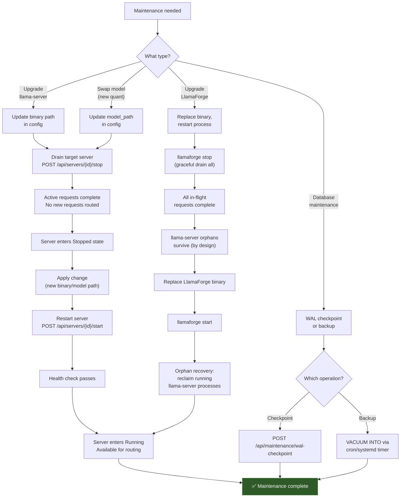

### 12.2 Graceful Shutdown Sequence

```
llamaforge stop
──────────────────────────────────────────────────
1. Stop accepting new connections (close listeners)
2. Signal all servers to drain:
   - No new requests dispatched to draining servers
   - In-flight requests continue until completion
3. Wait for drain timeout (configurable, default 30s)
4. For each server:
   - SIGTERM to llama-server process
   - Wait for graceful exit (5s)
   - SIGKILL if still alive
5. Flush metrics ring buffer to SQLite
6. Checkpoint WAL
7. Exit 0
```

### 12.3 Rolling Restart (Zero-Downtime for Multi-Instance Models)

When a model has multiple server instances, LlamaForge can perform rolling restarts:

```
Rolling Restart: qwen3-30b (2 instances)
──────────────────────────────────────────────────
Phase 1: Drain code-1
  code-1: ● Draining (finishing 3 active requests)
  code-2: ● Running  (absorbing new requests)

Phase 2: Restart code-1
  code-1: ● Starting (loading model...)
  code-2: ● Running  (handling all traffic)

Phase 3: Health check code-1
  code-1: ● Running  (health check passed ✅)
  code-2: ● Running  (traffic rebalancing)

Phase 4: Drain code-2
  code-1: ● Running  (absorbing new requests)
  code-2: ● Draining (finishing 5 active requests)

Phase 5: Restart code-2
  code-1: ● Running  (handling all traffic)
  code-2: ● Starting (loading model...)

Phase 6: Complete
  code-1: ● Running  ✅
  code-2: ● Running  ✅
  Zero requests dropped.
```

---

## 13. Cross-Cutting UX Principles

These principles apply across all journeys and UI surfaces. They define the "feel" of LlamaForge.

### 13.1 Progressive Disclosure

Show the minimum information needed at each level. Each UI surface has three depths:

| Depth | What's Shown | Who Uses It | Example |
|-------|-------------|-------------|---------|
| **Glance** | Status color + one number | Everyone, every visit | "● 3/3 servers up, 14 req/min" |
| **Inspect** | Key metrics + recent events | Operator checking in | Server cards with TPS, TTFT, slot usage |
| **Investigate** | Full detail, query tools | Operator debugging | Request Explorer with filters, log correlation |

### 13.2 Actionable Alerts, Not Noise

Every alert displayed in the UI must include:
1. **What** is wrong (symptom, not internal error code)
2. **Why** it matters (impact on users)
3. **What to do** (specific action or investigation step)

Bad: "Server health check failed"  
Good: "qwen3-30b (server-1) failed 3 consecutive health checks. Requests to this model are being routed to server-2 (code-2). Check if the llama-server process is running: `ps aux | grep llama-server`"

### 13.3 Consistent Vocabulary

Use consistent terms across CLI, Web UI, API, logs, and documentation:

| Concept | Term to Use | NOT |
|---------|------------|-----|
| A llama-server process | "server" or "server instance" | "worker", "node", "backend" |
| A model loaded in a server | "model" | "deployment", "endpoint" |
| A concurrent processing unit | "slot" | "thread", "worker", "connection" |
| A client's inference call | "request" | "job", "task", "query" |
| Shutting down while finishing work | "drain" | "graceful stop", "wind down" |
| The priority class of work | "task type" | "job class", "priority tier" |
| The entity sending requests | "requestor" | "client", "user", "tenant" |

### 13.4 CLI-Web UI Parity

Every action possible in the Web UI should also be possible via CLI. The CLI is not a second-class citizen — it is the scripting and automation interface:

| Web UI Action | CLI Equivalent |
|--------------|---------------|
| Dashboard overview | `llamaforge status` |
| Start server | `llamaforge server start <id>` |
| Stop server | `llamaforge server stop <id>` |
| View queue | `llamaforge queue list` |
| Cancel request | `llamaforge queue cancel <request-id>` |
| Boost priority | `llamaforge queue boost <request-id> --priority 900` |
| Reload config | `llamaforge config reload` |
| View config | `llamaforge config show` |
| Export config | `llamaforge config export > backup.toml` |
| Query metrics | `llamaforge metrics query --model qwen3-30b --last 1h` |
| View logs | `llamaforge logs --follow --level info` |
| WAL checkpoint | `llamaforge maintenance checkpoint` |

### 13.5 Real-Time Without Polling

The Web UI uses htmx with SSE or WebSocket polling for real-time updates. Key requirements:

- **Dashboard metrics:** Update every 2 seconds (matches health check interval)
- **Queue state:** Update on every enqueue/dequeue event via SSE
- **Server state:** Update on lifecycle transitions (not polling — event-driven via htmx `hx-trigger="sse:server-state"`)
- **Alert cards:** Appear/disappear as conditions are met/resolved

### 13.6 Offline-First Design

The Web UI is embedded in the binary (static files via `include_bytes!`). It works without internet access. No CDN dependencies for core functionality. ECharts and Alpine.js are bundled.

---

## 14. Extensibility Framework

The user journeys above cover LlamaForge v1. The UI/UX architecture must accommodate future capabilities without redesigning the core navigation or information hierarchy.

### 14.1 Extension Points

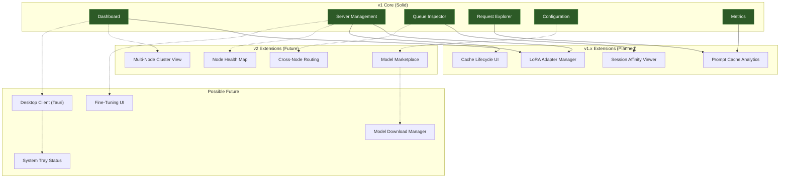

### 14.2 Navigation Architecture

The Web UI navigation should follow a hub-and-spoke model that naturally accommodates new sections:

```
Primary Navigation (sidebar or top bar)
├── Dashboard          (always first — the overview hub)
├── Servers            (server lifecycle, slots, LoRA adapters)
├── Queue              (queue inspector, admission control)
├── Requests           (request explorer, per-request detail)
├── Metrics            (charts, trends, capacity planning)
├── Configuration      (TOML viewer, reload, diff)
└── ─── future ────
    ├── Cluster        (v2: multi-node view)
    ├── Models         (v2: marketplace, download manager)
    └── Settings       (v2: auth, RBAC, API keys)
```

Each navigation item is a self-contained "page" with its own URL route (`/ui/servers`, `/ui/queue`, etc.). New features add new routes and sidebar entries without restructuring existing pages.

### 14.3 Desktop Client Evolution Path

When a Tauri-based desktop client is built, it should wrap the same Web UI with native enhancements:

| Feature | Web UI | Desktop Client |
|---------|--------|---------------|
| Dashboard | Same | Same, in native window |
| System tray | Not available | ● Green/Yellow/Red status indicator |
| Notifications | Not available | Native OS notifications for alerts |
| Auto-start | Not available | Start LlamaForge on system boot |
| Menu bar | Not available | Quick actions: start/stop, open dashboard |
| Model files | Manual path entry | Native file picker for model selection |
| GPU detection | Requires CLI | Automatic, displayed in setup wizard |

The desktop client is a thin native shell around the Web UI, not a separate codebase. The htmx + Alpine.js stack works in a Tauri webview without modification.

### 14.4 Plugin Architecture Hooks (Future)

The UI should eventually support plugins that add:
- New dashboard widgets (custom metric visualizations)
- Custom alert rules (beyond the built-in health signals)
- Integration panels (e.g., a HuggingFace model browser)
- Custom API endpoint registration (for domain-specific tooling)

These are achieved via the existing extension points: new `/ui/partials/*` routes for htmx fragments, new `/api/*` endpoints for data, and new sidebar entries.

---

## 15. UI Surface Mapping

A consolidated view of which UI surfaces serve which journeys and personas:

```mermaid
graph TD
    subgraph "Web UI Pages"
        WD["Dashboard"]
        WS["Server Management"]
        WQ["Queue Inspector"]
        WR["Request Explorer"]
        WC["Configuration Viewer"]
        WM["Metrics & Charts"]
    end

    subgraph "CLI Commands"
        CS["llamaforge status"]
        CSS["llamaforge server *"]
        CQ["llamaforge queue *"]
        CC["llamaforge config *"]
        CM["llamaforge metrics *"]
        CL["llamaforge logs *"]
    end

    subgraph "API Endpoints"
        A1["/v1/chat/completions"]
        A2["/v1/messages"]
        A3["/api/servers"]
        A4["/api/queue"]
        A5["/api/metrics"]
        A6["/metrics (Prometheus)"]
    end

    subgraph "Journeys"
        J1["J1: Install"]
        J2["J2: Model Setup"]
        J3["J3: Daily Ops"]
        J4["J4: API Integration"]
        J5["J5: Config Tuning"]
        J6["J6: Priority Mgmt"]
        J7["J7: Troubleshoot"]
        J8["J8: Scaling"]
        J9["J9: Observability"]
        J10["J10: Maintenance"]
    end

    J1 --> CS
    J2 --> WS & CSS
    J3 --> WD & CS
    J4 --> A1 & A2
    J5 --> WC & CC
    J6 --> WQ & CQ
    J7 --> WR & CL & WS
    J8 --> WS & WM & CSS
    J9 --> WM & A6 & CM
    J10 --> CSS & WS & A3
```

### 15.1 Page-Level Requirements Matrix

| Page | Real-Time? | Data Source | htmx Pattern | Priority |
|------|-----------|-------------|-------------|----------|
| Dashboard | Yes (2s) | Ring buffer + server state | SSE for metrics, polling for health | P0 — ship first |
| Server Management | Event-driven | Server Manager state | SSE on lifecycle events | P0 |
| Queue Inspector | Yes (event) | Queue + admission | SSE on enqueue/dequeue | P1 |
| Request Explorer | On-demand | SQLite audit log | Form submit + server-rendered table | P1 |
| Configuration Viewer | On-reload | Config Manager | Full page swap on reload event | P2 |
| Metrics & Charts | Yes (5s) | Prometheus + ring buffer | ECharts + SSE data feed | P2 |

---

## Appendix A: Wireframe Sketches

These ASCII wireframes define the spatial layout for each primary Web UI page. They serve as the starting point for visual design.

### A.1 Dashboard

```
┌──────────────────────────────────────────────────────────────────┐
│ ☰  LlamaForge                                    v0.1.0  ⚙️   │
├──────┬───────────────────────────────────────────────────────────┤
│      │                                                           │
│  📊  │  HEALTH STRIP                                            │
│ Dash │  ┌────────┐ ┌────────┐ ┌────────┐ ┌────────────────┐    │
│      │  │● Srvrs │ │● Queue │ │● Errs  │ │● Throughput    │    │
│  🖥️  │  │ 3/3    │ │ 2/100  │ │ 0.1%   │ │ 14.2 req/min  │    │
│ Srvr │  └────────┘ └────────┘ └────────┘ └────────────────┘    │
│      │                                                           │
│  📋  │  ┌────────────────────────┐ ┌────────────────────────┐   │
│ Queue│  │   THROUGHPUT CHART     │ │   TTFT DISTRIBUTION    │   │
│      │  │                        │ │                        │   │
│  🔍  │  │   [ECharts area chart] │ │   [ECharts histogram]  │   │
│ Reqs │  │                        │ │                        │   │
│      │  └────────────────────────┘ └────────────────────────┘   │
│  📈  │                                                           │
│ Mtrc │  SERVER CARDS                                            │
│      │  ┌──────────────┐ ┌──────────────┐ ┌──────────────┐     │
│  ⚙️  │  │ qwen3-30b    │ │ codellama    │ │ mistral-7b   │     │
│ Conf │  │ ● Running    │ │ ● Running    │ │ ● Draining   │     │
│      │  │ 6/8 slots    │ │ 3/4 slots    │ │ 1/4 slots    │     │
│      │  │ 22.4 TPS     │ │ 38.1 TPS     │ │ — TPS        │     │
│      │  └──────────────┘ └──────────────┘ └──────────────┘     │
└──────┴───────────────────────────────────────────────────────────┘
```

### A.2 Server Management Detail

```
┌──────────────────────────────────────────────────────────────────┐
│ ☰  Server: qwen3-30b (code-1)                   ← Back to list │
├──────┬───────────────────────────────────────────────────────────┤
│      │                                                           │
│ Nav  │  STATE: ● Running    Uptime: 2d 14h    PID: 28451       │
│      │  ┌─────────┐ ┌──────────┐ ┌───────┐ ┌──────────┐       │
│      │  │  Stop   │ │ Restart  │ │ Drain │ │  Config  │       │
│      │  └─────────┘ └──────────┘ └───────┘ └──────────┘       │
│      │                                                           │
│      │  CONFIGURATION                                           │
│      │  Model: /models/qwen3-30b-Q4_K_M.gguf                   │
│      │  GPU: 0 (RTX 3090)  VRAM: 17.2 / 24 GB                  │
│      │  Context: 8192   Batch: 512   Slots: 8                   │
│      │  Flash Attn: auto   Cache: f16/f16                       │
│      │                                                           │
│      │  SLOT STATUS                                             │
│      │  ┌─────┬────────┬───────┬────────┬──────────┐           │
│      │  │Slot │ State  │ Tokens│ TPS    │ Request  │           │
│      │  ├─────┼────────┼───────┼────────┼──────────┤           │
│      │  │  0  │●Active │ 1,204 │ 24.1   │ req-a3.. │           │
│      │  │  1  │●Active │   847 │ 22.8   │ req-b1.. │           │
│      │  │  2  │●Active │   312 │ 25.0   │ req-c2.. │           │
│      │  │  3  │○Idle   │     — │ —      │ —        │           │
│      │  │  4  │●Active │ 2,105 │ 21.3   │ req-d7.. │           │
│      │  │  5  │●Active │   156 │ 23.7   │ req-e4.. │           │
│      │  │  6  │●Active │ 1,890 │ 22.0   │ req-f9.. │           │
│      │  │  7  │○Idle   │     — │ —      │ —        │           │
│      │  └─────┴────────┴───────┴────────┴──────────┘           │
│      │                                                           │
│      │  PERFORMANCE (last 1h)                                   │
│      │  ┌────────────────────────────────────────────┐          │
│      │  │  [ECharts: TPS + TTFT over time]           │          │
│      │  └────────────────────────────────────────────┘          │
│      │                                                           │
│      │  LIFECYCLE HISTORY                                       │
│      │  10:32  Config reload → restart                          │
│      │  10:28  Started (health check passed in 4.2s)            │
│      │  08:15  Started (initial boot)                           │
└──────┴───────────────────────────────────────────────────────────┘
```

---

## Appendix B: Information Architecture

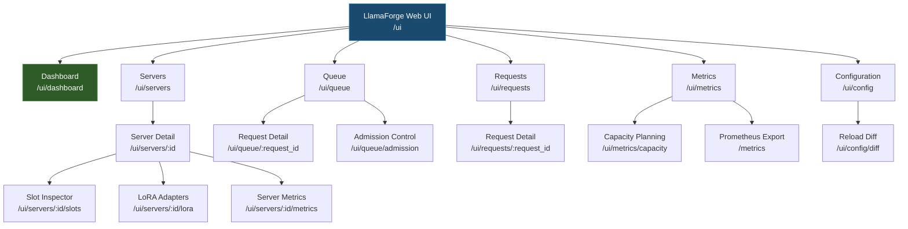

---

*This document defines user journeys for LlamaForge v1. It is a living document — update it as the product evolves and as user feedback reshapes priorities. Each journey should be validated against real user behavior during the Phase 5 (Web UI) implementation.*
